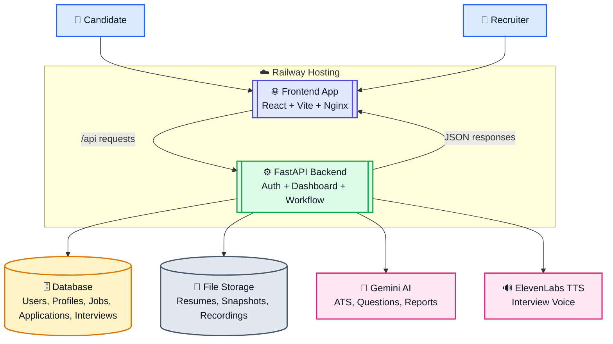
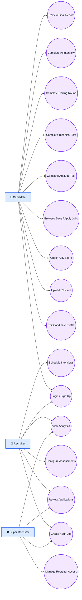
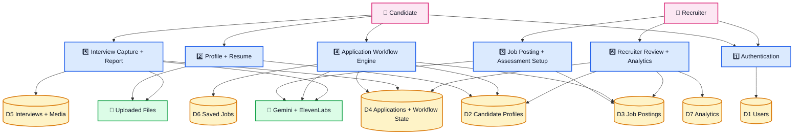

# Invenia AI System Guide

Live app: https://frontend-production-a792.up.railway.app/

HTML version: `docs/site/system-guide.html`
Landing page: `docs/site/index.html`

This guide reflects the current codebase as it exists today. It covers the implemented product flow, the module map, the current done-vs-pending state, a full usage manual, and the system diagrams.

## 1) Product Snapshot

Invenia AI is a dual-role hiring platform with:
- Candidate onboarding, profile building, resume upload, and ATS scoring
- Job browsing, saving, applying, and end-to-end assessment flow
- Recruiter job posting, candidate review, interview scheduling, and analytics
- AI-driven question generation for aptitude, technical, coding, and interview stages
- Voice-assisted interview questions with camera capture, transcript typing, and report generation

## 2) Modules

### Frontend Modules

| Module | File(s) | Purpose |
| --- | --- | --- |
| App shell | `frontend/src/App.jsx`, `frontend/src/main.jsx` | Sets up splash screen and route-based navigation |
| Splash screen | `frontend/src/components/SplashScreen.jsx` | Animated landing splash before login |
| Login selector | `frontend/src/pages/LoginSelector.jsx` | Role selection between Candidate and Recruiter |
| Candidate login | `frontend/src/pages/CandidateLogin.jsx` | Candidate email/password login |
| Recruiter login | `frontend/src/pages/RecruiterLogin.jsx` | Recruiter email/password login |
| Candidate sign-up | `frontend/src/pages/CandidateSignUp.jsx` | Candidate account creation |
| Candidate dashboard | `frontend/src/pages/CandidateDashboard.jsx` | Jobs, applications, ATS, workflow, interview, and profile management |
| Recruiter dashboard | `frontend/src/pages/RecruiterDashboard.jsx` | Job creation, pipeline review, analytics, recruiter management |
| API client | `frontend/src/services/api.js` | Axios wrapper, auth headers, file URL builder, typed API helpers |
| Frontend build/runtime | `frontend/Dockerfile`, `frontend/nginx.conf` | Railway frontend container and Nginx serving/proxy config |

### Backend Modules

| Module | File(s) | Purpose |
| --- | --- | --- |
| FastAPI app entry | `backend/main.py` | App startup, CORS, static mount, health checks, migrations, super recruiter bootstrap |
| Authentication core | `backend/auth.py` | Password hashing, JWT, role checks, current user helpers |
| Database layer | `backend/database.py` | SQLAlchemy engine, session, pool config |
| Data models | `backend/models.py` | Users, candidate profiles, recruiter profiles, jobs, applications, interviews, saved jobs, analytics |
| Schemas | `backend/schemas.py` | Request/response validation with Pydantic |
| Candidate router | `backend/routers/candidates.py` | Candidate profile CRUD endpoints |
| Recruiter router | `backend/routers/recruiters.py` | Recruiter profile CRUD and recruiter admin endpoints |
| User router | `backend/routers/users.py` | Current user profile endpoints |
| Auth router | `backend/routers/auth.py` | Register, login, OAuth login endpoints |
| Dashboard router | `backend/routers/dashboard.py` | Jobs, ATS, applications, workflow, interviews, analytics, uploads |
| Resume AI | `backend/resume_ai.py` | Resume text extraction and ATS scoring |
| Assessment AI | `backend/assessment_ai.py` | Gemini question generation, ElevenLabs TTS, interview report analysis |
| Workflow engine | `backend/workflow_utils.py` | Assessment configuration, workflow orchestration, scoring, serialization |
| Health and init | `backend/health.py`, `backend/init_db.py` | Health/status support and DB bootstrap helpers |
| Backend container | `backend/Dockerfile` | Railway backend container build |

### Runtime Data Stores

| Store | Role |
| --- | --- |
| Users | Auth, role, and account identity |
| Candidate profiles | Resume, ATS, skills, job preferences, availability |
| Recruiter profiles | Company details and recruiter identity |
| Job postings | Job description, salary, requirements, assessment config |
| Job applications | Candidate-to-job applications and workflow state |
| Interviews | Interview scheduling and status |
| Saved jobs | Candidate bookmarks |
| Analytics | Platform metrics and reporting support |
| Uploads | Resume files, interview snapshots, interview recordings |

## 3) What Is Done Right Now

### Login and Access
- Splash screen loads first.
- User chooses Candidate or Recruiter login path.
- Candidate sign-up is available.
- Email/password authentication works for both roles.
- JWT tokens are used after login.
- The backend has role-gated access for candidate and recruiter routes.

### Candidate Portal
- Candidate profile can be created and updated.
- Resume upload is supported.
- ATS score can be checked from the dashboard.
- ATS scan uses the stored profile plus uploaded resume and refreshes when needed.
- Candidate can browse jobs, search, filter, save, and apply.
- Candidate can open the application workflow preview before or after applying.
- Candidate can complete aptitude, technical, coding, and interview stages.
- Candidate can view application history and current status.

### Recruiter Portal
- Recruiter overview dashboard is available.
- Recruiter can create, edit, and archive jobs.
- Recruiter can configure aptitude, technical, and coding assessment rules.
- Recruiter can mark aptitude, technical, and coding as compulsory or optional.
- Interview stage is always compulsory.
- Recruiter can review candidates and applications.
- Recruiter can schedule and update interviews.
- Recruiter can view analytics.
- Super recruiter access management is available for recruiter accounts.

### AI and Assessment
- Gemini generates aptitude MCQs from the job context.
- Gemini generates technical MCQs from the job description and skills.
- Gemini generates coding prompts from the job description and skills.
- Gemini generates interview questions one turn at a time so the session can vary.
- ElevenLabs TTS is used for interview voice output when configured.
- If audio is unavailable, browser speech synthesis is used as fallback.
- Interview report analysis is produced by Gemini at the end of the interview flow.

### Interview and Proctoring
- Candidate interview flow supports camera access.
- Candidate interview flow supports live recording.
- Candidate interview flow supports snapshot capture.
- Candidate interview flow supports transcript typing.
- Candidate interview flow supports voice capture through the browser.
- Fullscreen and tab-switch warnings are tracked.
- Recording, snapshot, transcript, and proctoring data are stored with the application.

## 4) Current Gaps / Pending Items

These are the remaining gaps visible in the current codebase, not a product roadmap guess:

- OAuth login exists on the backend, but the login screens do not expose Google/GitHub/LinkedIn buttons yet.
- The "Forgot Password" UI is present, but a real reset flow is not implemented.
- Candidate and recruiter support actions currently show a coming-soon placeholder.
- Recruiter AI optimization currently shows suggestion text, not a one-click AI rewrite workflow.
- The proctoring layer is browser-based, so it is not yet a fully locked kiosk-style exam shell.
- There is no obvious built-in export/download button for the final interview report in the current UI.
- The current code does not show email/SMS notification workflows or calendar integrations.

## 5) Manual Guide

### Candidate Journey

#### Step 1: Open the app
- Go to: https://frontend-production-a792.up.railway.app/
- Wait for the splash animation to finish.
- Choose the Candidate path on the role selector.

#### Step 2: Sign up or log in
- If you are new, create a candidate account on the Sign Up page.
- If you already have an account, use the Candidate Login form.
- After login, you land on the Candidate Dashboard.

#### Step 3: Complete your profile
- Open the Profile tab.
- Add your full name, phone, location, current role, company, experience, skills, job preferences, and links.
- Mark availability if you are actively looking.
- Save the profile.

#### Step 4: Upload your resume
- Open the resume section in the dashboard.
- Upload a PDF, DOC, or DOCX resume.
- After upload, the system refreshes the ATS analysis.

#### Step 5: Check ATS score
- Use the ATS scan button.
- Review the score, summary, breakdown, strengths, gaps, and optimization tips.
- If you update your resume or profile, re-run the scan.

#### Step 6: Search and save jobs
- Use the Jobs tab to search by title, location, or keywords.
- Open any job card to review the details.
- Save jobs you want to revisit.

#### Step 7: Apply for a job
- Open the job and click Apply.
- Add a cover letter if desired.
- The workflow preview shows which stages are compulsory or optional.

#### Step 8: Complete the assessment stages
- Stage 1: Profile review
- Stage 2: Aptitude test
- Stage 3: Technical test
- Stage 4: Coding round
- Stage 5: AI interview

### Candidate Assessment Rules
- Aptitude test can be compulsory or optional depending on recruiter setup.
- Technical test can be compulsory or optional depending on recruiter setup.
- Coding round can be compulsory or optional depending on recruiter setup.
- AI interview is compulsory.
- Aptitude and technical tests use 5 questions.
- Coding round uses 2 prompts.
- Interview uses 3 AI-generated questions.

#### Step 9: Aptitude test
- Answer the MCQs inside the workflow modal.
- Submit the answers before the timer finishes.
- If the recruiter marked it optional, you can skip it.

#### Step 10: Technical test
- Answer the role-specific MCQs.
- Submit before the timer ends.
- If optional, you may skip it.

#### Step 11: Coding round
- Write the coding answers in the code boxes.
- Submit the round when you are ready.
- If optional, you may skip it.

#### Step 12: AI interview
- Start camera access.
- Click Begin Full-Screen Interview.
- Allow camera and microphone permissions.
- The system captures a snapshot, starts live recording, and requests fullscreen.
- Each question is spoken aloud.
- Use Start Voice Capture to let speech-to-text fill your answer quickly.
- Type manually if needed.
- Submit the answer to move to the next question.
- Repeat until all 3 questions are completed.

#### Step 13: Review result
- After the last interview answer, the system generates the final report.
- You can review:
  - ATS score
  - Job match score
  - Coding score
  - Interview report
  - Overall workflow score
- Your application remains in your application history for later review.

### Recruiter Journey

#### Step 1: Log in
- Go to the same live app URL.
- Choose Recruiter on the role selector.
- Log in with recruiter credentials.

#### Step 2: Open the dashboard
- The Recruiter Dashboard opens to the overview area.
- You can see active jobs, applications, interviews, and hiring metrics.

#### Step 3: Create a job
- Open the Jobs tab.
- Click Create Job.
- Enter title, description, location, job type, salary range, skills, responsibilities, and benefits.

#### Step 4: Configure assessment stages
- For aptitude:
  - Mark as compulsory or optional
  - Choose AI generated or manual MCQs
  - Set cutoff and duration
- For technical:
  - Mark as compulsory or optional
  - Choose AI generated or manual MCQs
  - Set cutoff and duration
- For coding:
  - Mark as compulsory or optional
  - Provide manual prompts if needed
- For interview:
  - The interview stage is always compulsory
  - The system uses a 3-question AI voice interview

#### Step 5: Publish or update the job
- Save the job to activate the workflow setup.
- Edit later if you want to change assessment configuration or job details.
- Archive the job when it is no longer active.

#### Step 6: Review applications
- Open the Applications or Candidates area.
- Review each candidate’s profile, ATS score, job match, and workflow summary.
- Change application status when needed.

#### Step 7: Schedule interviews
- Use the interview scheduler from a candidate profile or applications view.
- Set interview type, date/time, duration, location/link, and notes.
- Save the interview.

#### Step 8: Review interviews and analytics
- Open the Interviews tab for scheduled sessions.
- Open the Analytics tab for funnel and hiring metrics.
- Review conversion rate, candidate quality, diversity, and time-to-hire.

#### Step 9: Manage recruiter access
- If you are the super recruiter, open the Recruiters tab.
- Create or disable recruiter accounts as needed.

## 6) System Architecture Diagram

## 7) Use-Case Diagram

## 8) Data Flow Diagram

## 9) Notes

- The live user entry point is the Railway frontend URL shown at the top of this document.
- The architecture and flow above describe the current implementation, not a future roadmap.
- Mermaid rendering depends on the viewer. GitHub, many Markdown viewers, and some IDE previews will render these diagrams directly.
